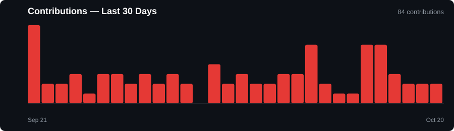

# Anwin Jojo

**Backend Developer · Systems & Rust Explorer · ML Enthusiast**

I build reliable backend systems with Python and Rust, architect databases and REST APIs, and explore machine learning and computer vision. I enjoy deep-diving into Data Structures & Algorithms, memory safety, and understanding how software systems work under the hood.

  
  
  

---

## 🛠️ Tech Stack & Skills

| Area                     | Technologies & Tools                                                  |
| ------------------------ | --------------------------------------------------------------------- |
| **Languages**            | Python · Rust · Java · C · JavaScript                                 |
| **Backend & Systems**    | Django · Flask · Rust CLI Tooling · REST APIs                         |
| **Databases**            | PostgreSQL · MySQL · MongoDB · Supabase                               |
| **Machine Learning**     | TensorFlow · Scikit-learn · Computer Vision · OpenCV                  |
| **Tools & Environments** | Git · GitHub · Linux · Docker · Cargo · VS Code                       |
| **Core Interests**       | Backend Engineering · Systems Programming · DSA · ML · System Design |

  
  
  
  
  
  

---

## 🚀 Featured Projects

### 🧹 [CleanSweep](https://github.com/guess-watt/CleanSweep)
A fast, safe Windows command-line storage analyzer written in **Rust**. Scans directories recursively, identifies space-consuming files, and detects exact duplicates using streaming **SHA-256** content verification with zero runtime memory bloat.

`Rust` `Systems Programming` `CLI` `SHA-256` `File Systems`

---

### ♜ FORTRESS
A chess analysis and anomaly-detection system utilizing chess-engine evaluation and machine learning to detect statistically unusual gameplay patterns.

`Python` `Django` `python-chess` `Stockfish` `Machine Learning`

---

### ♟️ Chess Theory Platform
A structured platform for mastering chess theory through rich explanatory articles and interactive analysis.

`Django` `Python` `JavaScript` `Database`

---

### 🤖 Machine Learning Experiments
Computer vision and deep learning experiments on real-world datasets focusing on model architecture, transfer learning, and image classification.

`Python` `TensorFlow` `MobileNet` `Computer Vision`

---

### 🏥 MediTrack
A backend-focused healthcare management platform engineered with agile practices and relational database schemas.

`Django` `Python` `PostgreSQL` `Agile`

---

## 📈 GitHub Activity & Stats

  
  

  

  

---

<b>🔭 Current Focus & Learning Journey</b>

 

* **Systems Programming in Rust**: Memory safety, zero-cost abstractions, CLI architecture, and low-level I/O.
* **Backend Architecture & Scalability**: Designing resilient APIs, microservices, and database indexing.
* **Advanced DSA**: Honing algorithmic problem solving and time-complexity optimization.
* **Applied Machine Learning**: Practical computer vision pipelines and inference optimization.

<b>💡 More About Me</b>

 

I love transforming complex concepts into clean, maintainable software. Whether it's crafting a high-speed systems utility in Rust, optimizing a Django REST API, or training a vision model, I take pride in understanding how things operate under the hood.

My work sits at the intersection of **systems engineering, backend infrastructure, algorithms, and applied machine learning**.

---

## 📬 Connect

  
  
  

  Code → Learn → Build → Repeat

